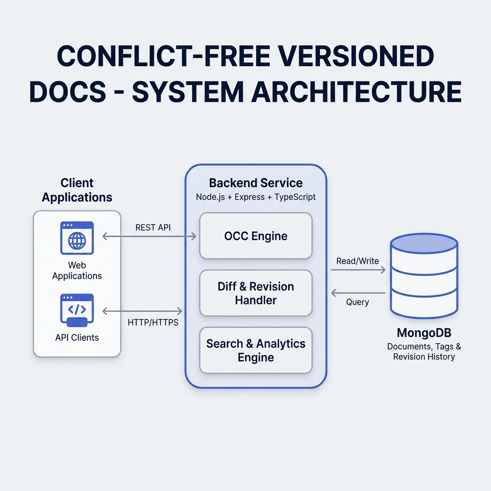
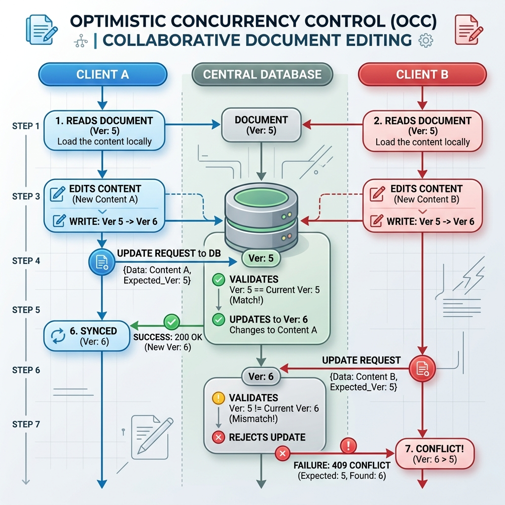

# Collaborative Document Store

A production-ready collaborative wiki backend built with MongoDB, featuring an interactive Web UI dashboard, Optimistic Concurrency Control (OCC), incremental revision history, full-text search with tag filtering, and automated dual-strategy schema migrations.

---


## 🎥 Project Demo

[](https://youtu.be/FxfwO-WQ1RI)

---

## 📐 System Architecture

Below is the high-level architecture of the backend service. It details the interaction between client applications, the core service engines, and MongoDB.



---

## 🖥️ Interactive Web UI Dashboard

To make testing and demonstrating this backend intuitive, the server hosts a premium, responsive glassmorphic Web UI dashboard directly at the root route. 

Open **`http://localhost:3000`** in your browser to access the playground:

* **Live Wiki Browser**: Search documents using text queries with real-time matching and compound tag filters.
* **Inline Document Editor**: Edit existing wiki pages or draft new documents with custom tags and authorship meta.
* **Revision History Timeline**: View a document's edit timeline and expand individual cards to inspect the line-by-line jsdiff patch of changes.
* **OCC Concurrency Simulator**: Use the toggle switch to deliberately send an outdated version to the API. This triggers a `409 Conflict` database exception on save, showcasing how the server blocks concurrent updates.
* **OCC Conflict Resolution Modal**: When a conflict occurs, a side-by-side comparative diff modal displays "Your Changes" against the "Latest Database Version" with a one-click button to adopt the latest db content.
* **Live System Analytics**: View live metrics for the Top 10 Most-Edited documents and the O(N) Tag Co-occurrence matrix card grid.

---

## 🎛️ Optimistic Concurrency Control (OCC) Flow

To prevent the "Lost Update" problem in collaborative editing environments, the system implements a version-based Optimistic Concurrency Control strategy using atomic MongoDB operations (`findOneAndUpdate`).

The flow diagram below demonstrates how concurrent edits are processed and how version conflicts are detected:



### OCC Logic Details:
1. When a client reads a document, it receives the document with its current `version` (e.g., `version: 5`).
2. When the client sends an update (`PUT /api/documents/:slug`), it must include the version it read (`version` in the request body).
3. The server executes a single atomic `findOneAndUpdate` matching `{ slug, version: expectedVersion }`.
4. If another client has updated the document in the meantime, the database version will have incremented (e.g., to `6`), and the update will fail to match. The server returns a `409 Conflict` along with the latest database document to allow the client to resolve/merge the differences.

---

## 🛠️ Tech Stack
- **Runtime**: Node.js (v20)
- **Language**: TypeScript (strict mode)
- **Framework**: Express.js
- **Database**: MongoDB 7
- **Testing**: Jest & Supertest
- **Diffing Library**: `diff` (jsdiff)

---

## 🌟 Core Features

- **Optimistic Concurrency Control (OCC)**: Atomic version checks that prevent concurrent overwrites without database-level locks.
- **Revision History**: Compact patch-based change history that records text diffs using the `diff` library. Only the last 20 revisions are retained via MongoDB `$slice` capping.
- **Full-Text Search with Tag Filters**: Compound text queries using MongoDB `$text` search combined with `$all` tag matching, sorted dynamically by text relevance score.
- **Optimized Analytics**:
  - **Most Edited**: Aggregation using `$size` of revision array to retrieve the top 10 most-revised wiki pages.
  - **Tag Co-occurrence**: High-performance $O(N)$ pipeline that maps combinations of tags within individual documents to count co-occurrence frequencies without expensive `$lookup` self-joins.
- **Zero-Downtime Schema Evolution**:
  - **Lazy (On-Read) Migration**: Converts legacy string author schemas to structured object schemas on the fly when read, writing the change back asynchronously.
  - **Background Batch Migration**: Standalone script (`scripts/migrate_author_schema.js`) processing documents in batches via MongoDB bulk writes for complete dataset updates.

---

## 🚀 Getting Started

### Prerequisites
- Docker & Docker Compose

### Building and Running
1. Clone the repository.
2. Build and start the services using Docker Compose:
   ```bash
   docker-compose up -d --build
   ```
3. The API and Web UI Dashboard will start up on `http://localhost:3000`.
4. On the first run, the MongoDB database is automatically seeded with at least 1,000 documents parsed from Wikipedia stub articles. You can monitor seeding progress by checking the container logs:
   ```bash
   docker-compose logs -f api
   ```

### Running Tests
To run the automated integration test suite:
```bash
npm run test
```

---

## 🔌 API Endpoints

### Documents API
- `POST /api/documents` - Create a new document.
- `GET /api/documents/:slug` - Retrieve a document (triggers lazy migration if legacy schema is found).
- `PUT /api/documents/:slug` - Update a document (requires `version` in the request body for OCC).
- `DELETE /api/documents/:slug` - Delete a document.

### Search & Analytics API
- `GET /api/search?q=<search_query>&tags=<tag1>,<tag2>` - Search documents by relevance score, with optional tag filters.
- `GET /api/analytics/most-edited` - Get top 10 most revised documents.
- `GET /api/analytics/tag-cooccurrence` - Get the list of tags commonly used together, sorted by frequency.

### Schema Migration
To manually trigger the background bulk migration script:
```bash
docker exec collaborative_api node scripts/migrate_author_schema.js
```
